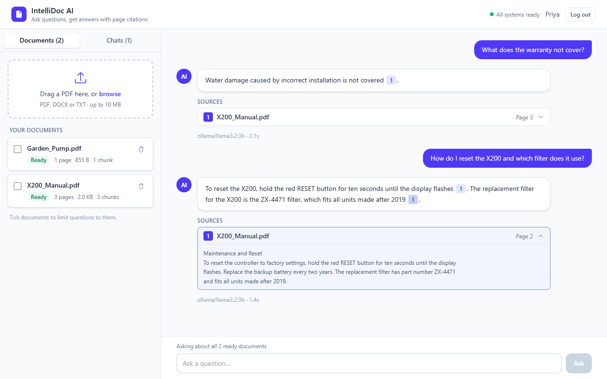
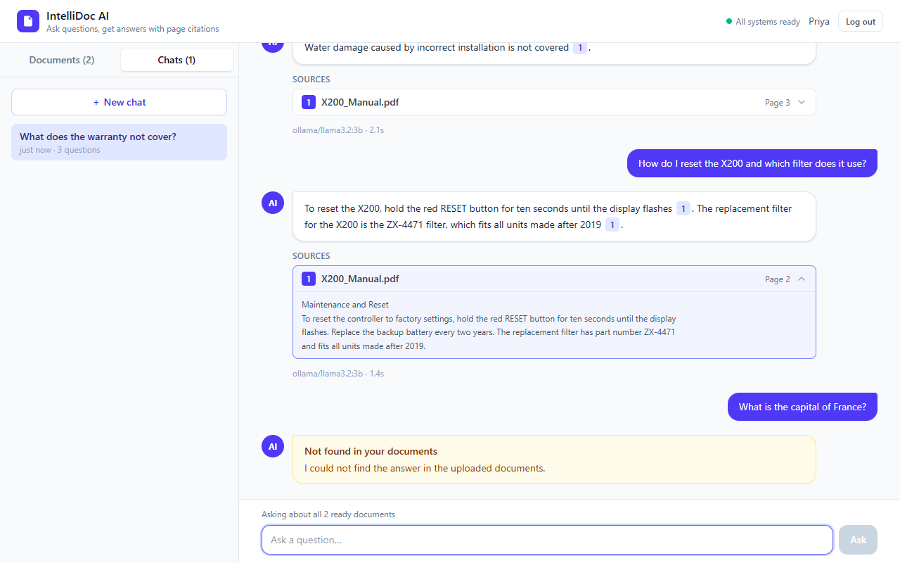
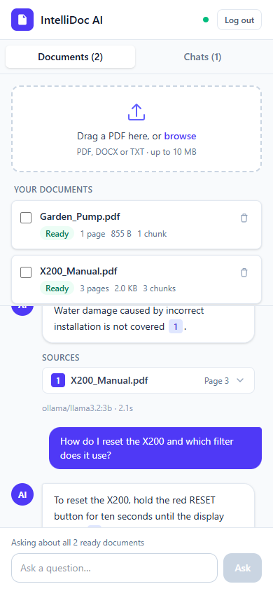
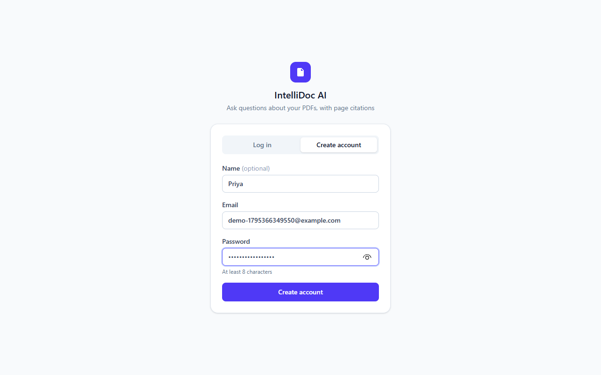
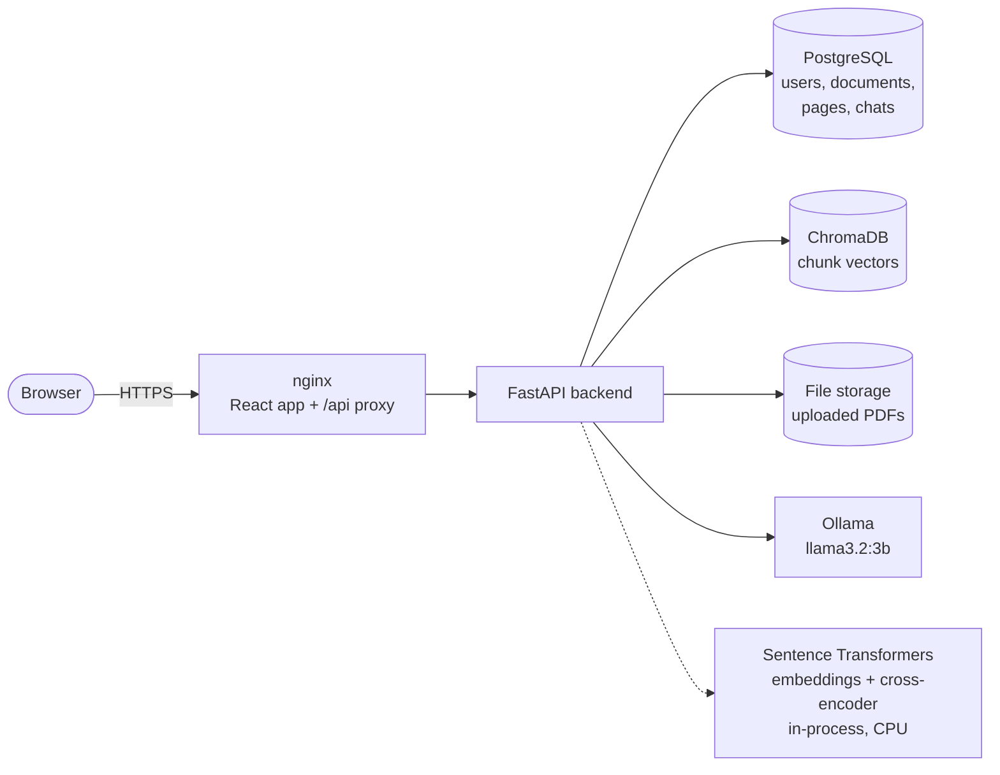
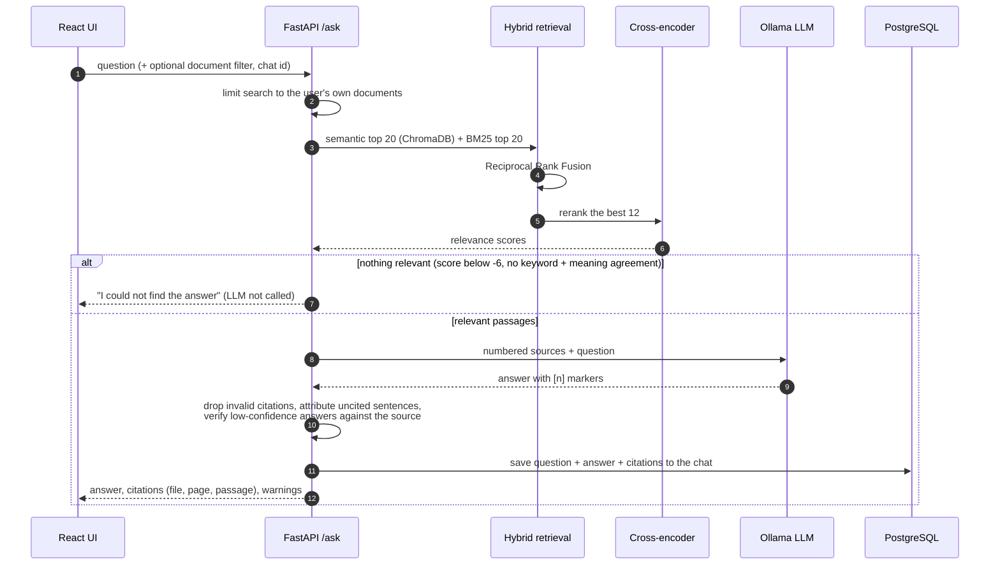

# IntelliDoc AI

**Ask questions about your PDFs and get answers with page citations, using AI that runs entirely on your own machine.**

Upload documents, ask in plain English, and every answer cites the exact page it came from. Click a citation to see the passage. When the documents don't contain the answer, IntelliDoc says so instead of making one up.



<table>
<tr>
<td width="50%"></td>
<td width="25%"></td>
<td width="25%"></td>
</tr>
<tr>
<td>Chat history, and an honest "not found"</td><td>Works on phones</td><td>Accounts with private data</td>
</tr>
</table>

## Features

- **Page-aware PDF extraction** (PyMuPDF): text, page numbers and metadata. Corrupted, password-protected, fake and oversized files are rejected with clear messages.
- **Hybrid retrieval**: semantic search (Sentence Transformers + ChromaDB) and keyword search (BM25), fused with Reciprocal Rank Fusion, then reranked by a cross-encoder.
- **Grounded answers from a local LLM** (Ollama `llama3.2:3b`, or a built-in Hugging Face model, or no LLM at all) with `[n]` citations that are checked against the sources.
- **Whole-document requests**: "Summarize this document", "main topics" or "key points" get excerpts spread from the first to the last page, instead of a similarity search that can't match them.
- **No hallucination by design**: when no passage is relevant, the LLM is not even called. A low-confidence fallback only answers if the answer is visibly backed by the source text.
- **Accounts** (Argon2 password hashing, JWT login). Every document, search, answer and chat is private to its owner.
- **Chat history** stored in PostgreSQL: reopen, continue, rename or delete conversations.
- **React + Tailwind UI**: drag-and-drop upload, clickable citations, loading and error states, a live health indicator ("AI model offline"), and a mobile layout.
- **Tested end to end**: 149 backend tests (92% coverage) on SQLite and PostgreSQL, 42 frontend tests, and 8 real-browser tests. A single command runs everything.
- **One-command deployment** with Docker Compose (PostgreSQL, Ollama, FastAPI, nginx), and CI that builds and smoke-tests the containers.

## How it works



**Answering a question**



More detail, including the data model, design decisions and measured thresholds, is in [docs/ARCHITECTURE.md](docs/ARCHITECTURE.md).

## Tech stack

| Layer | Technology |
|---|---|
| Frontend | React 19, Vite 8, Tailwind CSS 4 |
| API | FastAPI, Pydantic 2, Uvicorn |
| Database | PostgreSQL 17 via SQLAlchemy 2 (SQLite also supported, e.g. for tests) |
| PDF extraction | PyMuPDF |
| Embeddings | `sentence-transformers/all-MiniLM-L6-v2` (384-dim) |
| Vector store | ChromaDB (cosine) |
| Keyword search | BM25 (`rank-bm25`, BM25Plus) |
| Reranker | `cross-encoder/ms-marco-MiniLM-L-6-v2` |
| LLM | Ollama `llama3.2:3b` (default), Hugging Face Transformers (`Qwen2.5-0.5B-Instruct`), or extractive |
| Auth | Argon2id (`pwdlib`), JWT (`PyJWT`) |
| Testing | pytest, Vitest + Testing Library, Playwright, ruff |
| Deployment | Docker Compose, nginx, GitHub Actions |

## Quick start with Docker

Requires Docker with Compose v2 and about 6 GB of free RAM for the default LLM.

```bash
cp .env.docker.example .env          # then set POSTGRES_PASSWORD and SECRET_KEY
docker compose up -d --build
```

Open **http://localhost:8080** and create an account. The first start downloads the Ollama model (~2 GB), and the health dot shows "AI model offline" until it's ready. On a small server, set `LLM_PROVIDER=extractive` to run without an LLM. For an NVIDIA GPU: `docker compose -f docker-compose.yml -f docker-compose.gpu.yml up -d`.

See [docs/DEPLOYMENT.md](docs/DEPLOYMENT.md) for configuration, HTTPS, backups and updates.

## Local development (Windows)

Prerequisites: Python 3.11, Node 22+, and optionally [Ollama](https://ollama.com) and PostgreSQL. SQLite works out of the box.

```bash
python -m venv .venv
.venv\Scripts\python.exe -m pip install torch --index-url https://download.pytorch.org/whl/cpu
.venv\Scripts\python.exe -m pip install -r backend\requirements-dev.txt
cd backend && ..\.venv\Scripts\python.exe -m uvicorn app.main:app --reload --port 8000
```

In a second terminal:

```bash
cd frontend && npm install && npm run dev
```

Open http://localhost:5173. The API docs are at http://localhost:8000/docs. Settings live in `backend/.env` (see [backend/.env.example](backend/.env.example)). For example, `LLM_PROVIDER=ollama` with `ollama pull llama3.2:3b`, or a PostgreSQL `DATABASE_URL`.

## Testing

```bash
powershell -ExecutionPolicy Bypass -File scripts\run-all-tests.ps1
```

| Suite | What it covers | Count |
|---|---|---|
| Backend (pytest) | extraction, chunking, search, RAG, auth, privacy, chat history, readiness, summaries, failures, concurrency; runs on SQLite **and** PostgreSQL | 149 (+ 6 real-model tests with `-WithModels`) |
| Frontend (Vitest) | every component, login and session expiry, chat history, errors, upload states | 42 |
| End to end (Playwright) | a real browser against the real backend and models: full journey, bad files, "not found", two-user privacy, auth, deletion, phone layout | 8 |
| Deployment smoke test | runs against a live stack through nginx: headers, routing, upload, answer, limits (`backend/scripts/smoke_test.py`) | 16 checks |

CI ([.github/workflows/ci.yml](.github/workflows/ci.yml)) runs all of these on every push, then builds the Docker images, starts the stack and runs the smoke test against it.

## API

All routes are under `/api/v1`. Everything except `health` and `auth` requires `Authorization: Bearer <token>`.

| Method | Path | Purpose |
|---|---|---|
| POST | `/auth/register`, `/auth/login` | create an account / log in (returns a JWT) |
| GET | `/auth/me` | current user |
| POST / GET | `/documents` | upload (extract + index) / list my documents |
| GET / DELETE | `/documents/{id}` | details with full text / delete everywhere |
| GET | `/documents/{id}/pages[/{n}]`, `/documents/{id}/chunks` | page text, indexed chunks |
| POST | `/documents/{id}/index` | rebuild the search index for a document |
| POST | `/search`, `/search/hybrid` | semantic or hybrid search with scores |
| POST | `/ask` | grounded answer with citations; saved to a chat |
| GET / POST / PATCH / DELETE | `/chats[/{id}]` | chat history |
| GET | `/health`, `/health/ready` | liveness; readiness of the database, vector store and LLM |

## Project structure

```
backend/
  app/
    api/v1/endpoints/   auth, documents, search, ask, chats, health
    core/               settings (.env), security (Argon2, JWT)
    db/ models/ schemas/
    services/           extraction, chunking, embeddings, vector_store, keyword_search,
                        hybrid_search, reranker, llm, rag, storage, indexing
  scripts/              migrate SQLite -> PostgreSQL, smoke test, model download, e2e server
  tests/                149 tests
  Dockerfile
frontend/
  src/components/       UploadZone, DocumentList, ChatPanel, AnswerMessage, ChatList, LoginScreen
  src/lib/              API client, citation parsing
  e2e/                  Playwright tests + fixture PDFs
  nginx/ Dockerfile
scripts/                run-all-tests, start/stop portable PostgreSQL
docs/                   architecture, deployment, portfolio, screenshots
docker-compose.yml
```

## Security notes

- Passwords are hashed with Argon2id, and logins are equally slow for unknown emails, so timing doesn't reveal which accounts exist.
- Another user's document or chat returns 404, never 403, so its existence is not revealed.
- Uploads are checked by extension, MIME type and file signature, stored under random names, size-limited, and protected against path traversal.
- Crashes return a generic error. Tracebacks stay in the server log, never in responses.
- nginx sends a strict Content Security Policy and other security headers. Only the web port is published.
- `ENVIRONMENT=production` refuses to start with the default `SECRET_KEY`.

## Limitations

- Scanned PDFs without a text layer need OCR, which isn't included yet.
- The relevance thresholds were tuned on small sample documents and may need adjusting for very different content (see [docs/ARCHITECTURE.md](docs/ARCHITECTURE.md#retrieval-thresholds)).
- One backend worker by design: models are loaded once, and ChromaDB's local storage is single-process.
- Follow-up questions are answered on their own; earlier messages aren't sent to the LLM.
