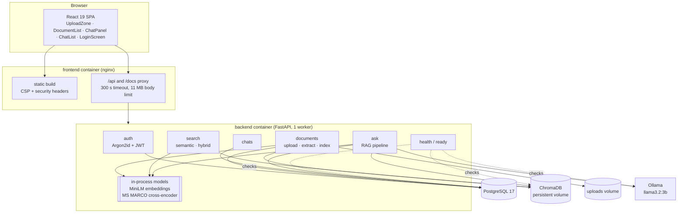
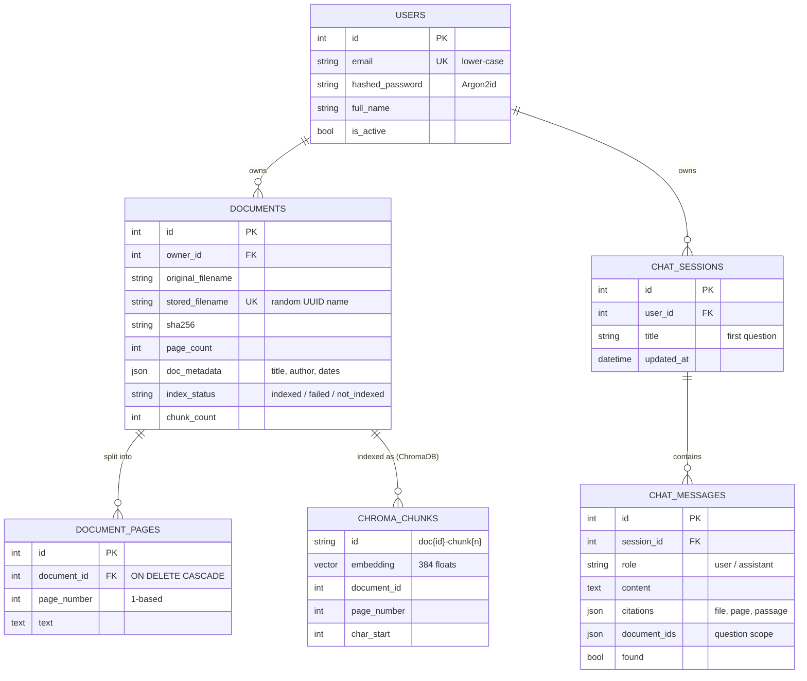

# Architecture

This document explains how IntelliDoc AI is built and why. For setup, see the [README](../README.md); for running it on a server, see [DEPLOYMENT.md](DEPLOYMENT.md).

## Components

## Data model

Chunk IDs embed the document ID, so re-indexing replaces a document's vectors in place, and deleting a document removes exactly its own vectors. Moving from SQLite to PostgreSQL keeps document IDs (`scripts/migrate_sqlite_to_postgres.py`), so existing vectors stay valid.

## Upload pipeline

1. **Validate**: allowed extension, declared MIME type, and file signature (`%PDF`). Size is checked while streaming, so a 2 GB upload is cut off at the limit instead of filling the disk.
2. **Store** under a random UUID name; the original name is sanitised for display only.
3. **Extract** page by page with PyMuPDF, opened from memory so Windows never locks the file. Encrypted → 422, corrupt → 422, over `MAX_PDF_PAGES` → 413. On any failure the stored file is deleted.
4. **Chunk**: about 1000 characters with 200 characters of overlap, preferring paragraph and sentence boundaries. Chunks never cross pages, so every chunk has exactly one page number.
5. **Embed** with MiniLM (normalised vectors) and upsert into ChromaDB. An indexing failure keeps the upload with `index_status=failed`, and the UI offers an **Index** button to retry.

## Answer pipeline (`POST /ask`)

| Step | Detail |
|---|---|
| Scope | Only the caller's own document IDs, intersected with the optional filter. An empty scope means "not found" with no search. |
| Semantic retrieval | Top 20 by cosine similarity in ChromaDB |
| Keyword retrieval | BM25Plus over the same chunks (top 20). The tokenizer keeps codes like `ZX-4471` as one token, and the index rebuilds when the vector store changes. |
| Fusion | Reciprocal Rank Fusion, `k = 60` |
| Rerank | Cross-encoder scores the best 12 fused chunks |
| Gate | Chunks scoring below `RERANK_MIN_SCORE` (−6) are dropped; if none remain, see the fallback below, otherwise "not found" **without calling the LLM** |
| Prompt | Up to 5 numbered sources (6000 characters), a strict "answer only from the sources, cite [n]" system prompt, and a format example |
| Generation | Ollama `llama3.2:3b`, temperature 0.1, `num_ctx` 4096 |
| Post-processing | Remove citations to non-existent sources; add a citation to uncited sentences that mostly match one source (≥ 60% of words); flag answers with no citations |
| Save | User and assistant messages, with citations, go into the chat (new chat titled by the question if no `chat_id` was given). Failed answers are not saved. |

### Whole-document requests

"Summarize this document", "What is this PDF about?", "main topics" and "key points" contain no topic words, so similarity search finds nothing relevant. Before this was handled, they were the main source of "not found" answers on a real 44-page document. Such requests are detected by trigger phrases plus a check that no other topic word remains, so "Summarize the AES section" still uses normal retrieval. They skip the reranker gate and get `RAG_SUMMARY_CHUNKS` (8) excerpts spread evenly from the first to the last chunk, shared across documents when several are in scope (with a note to tick one), within `RAG_SUMMARY_MAX_CONTEXT_CHARS` (8000). Models often place citations after the full stop ("... VPNs. [1]"); these are moved before it, so they aren't treated as uncited and duplicated.

### Retrieval thresholds

The cross-encoder sometimes under-scores indirect wording. "Which filter cartridge should I buy?" scores −9.6 against the passage containing the filter part number. On the sample documents, off-topic questions scored between −11.3 and −11.0, so lowering the cutoff would leave almost no margin. Instead there's a two-check fallback, used only when nothing passes −6:

1. **Retrievers agree**: the best chunk must match by keyword (BM25) *and* have semantic similarity ≥ 0.25. Measured: off-topic questions never had a keyword match and stayed ≤ 0.12; the rescued questions were 0.31–0.40.
2. **The answer is in the source**: at least one sentence of the generated answer must be ≥ 60% source words. The real filter answers scored 0.85–0.92. An invented "refer to page 5 of the manual" answer to a WiFi question (the manual has no WiFi section) scored 0.14 and was replaced with "not found".

Answers produced this way carry a visible low-confidence warning. On 40 test questions: all 20 answerable ones reached the LLM, all 14 off-topic ones were stopped before it, and the near misses were answered "not found". The settings are `RERANK_FALLBACK_MIN_SEMANTIC` and `LOW_CONFIDENCE_MIN_SUPPORT`.

## Authentication and privacy

- `POST /auth/login` uses the OAuth2 password form, so the **Authorize** button in `/docs` works. Tokens are HS256 JWTs (1 day), with `sub`, `exp` and `type` required.
- The frontend keeps the token in `localStorage`. Any 401 on a logged-in request logs out with "Your session expired".
- Every query filters by owner. Requesting someone else's document ID is silently ignored in search, and returns 404 on direct access.
- The first account adopts documents uploaded before accounts existed (`ADOPT_UNOWNED_DOCUMENTS`), so upgrading never hides data.

## Design decisions

| Decision | Why |
|---|---|
| Local models only | Documents never leave the machine; no API keys or per-question cost |
| Hybrid search + reranker | Embeddings miss exact codes and part numbers; BM25 misses paraphrases. Fusion catches both, and the cross-encoder fixes the order. |
| Gate before the LLM | The cheapest way to avoid hallucinations is not to ask the model when nothing relevant was found |
| Citations verified in code | Small models forget or invent `[n]` markers; the backend repairs or rejects them instead of trusting the model |
| One backend worker | The models are loaded once per process (several hundred MB of RAM), and ChromaDB's persistent client must be single-process. Concurrency comes from FastAPI's thread pool; CPU-heavy work runs off the event loop. |
| Lazy, locked model and store loading | Fast startup and tests that don't need models; locks prevent double loading (a real race on a fresh ChromaDB folder was found and fixed in Phase 8) |
| Non-destructive schema upgrades | `init_db` creates missing tables and adds nullable columns; no data is ever dropped |
| Dependency injection everywhere | Tests replace the embedder, vector store, reranker, LLM and database without touching real data |
| No tracebacks in responses | FastAPI debug mode would bypass the error handler and leak code paths, so it's always off |

## Observability

- `GET /api/v1/health`: process is up (container health checks).
- `GET /api/v1/health/ready`: database `SELECT 1`, ChromaDB chunk count, LLM check (Ollama `/api/tags` plus model presence). Returns 200 or 503 with details per component. The UI polls it every minute.
- Every `/ask` response includes `timings_ms` for each step (semantic, BM25, rerank, LLM) and the models used.
