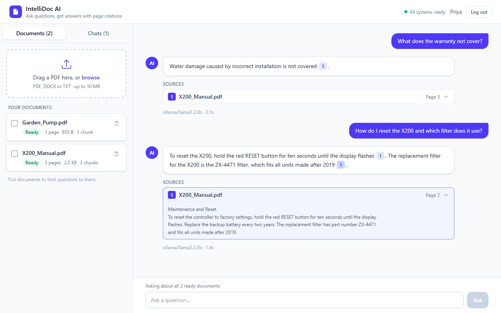

# IntelliDoc AI: portfolio summary

> A private "chat with your PDFs" app that answers only from your documents, cites the exact page, and runs entirely on local hardware.

## The problem

Generic chatbots answer questions about documents confidently, even when the answer isn't in the document, and they rarely show where an answer came from. Sending private documents to a cloud API is also often not an option.

## What I built

A full-stack retrieval-augmented generation (RAG) system:

- **Backend**: FastAPI, 21 REST endpoints. Page-aware PDF extraction, chunking, embeddings, ChromaDB, BM25, rank fusion, cross-encoder reranking, and a local LLM via Ollama.
- **Frontend**: React 19 + Tailwind. Drag-and-drop upload, chat with clickable citations that open the source passage, chat history, a live health indicator, and a mobile layout.
- **Data**: PostgreSQL for users, documents, pages and chats; ChromaDB for vectors. A non-destructive migration path from the original SQLite setup.
- **Security**: Argon2id passwords, JWT auth, strict per-user isolation, file signature checks, CSP headers, and no internal error details in responses.
- **Delivery**: Docker Compose stack (nginx, FastAPI, PostgreSQL, Ollama) and a GitHub Actions pipeline that builds the containers and smoke-tests them.

## Technical highlights

**1. Hybrid retrieval beats either method alone.** Semantic search misses exact identifiers like `ZX-4471`; keyword search misses paraphrases. I run both, fuse them with Reciprocal Rank Fusion, and rerank the top 12 with a cross-encoder. A custom tokenizer keeps part numbers intact, and BM25Plus avoids the negative-IDF problem that made classic BM25 drop real matches on small collections.

**2. Refusing to answer is a feature.** If no passage passes the reranker threshold, the LLM is never called and the user sees "not found". Citations in the model's answer are parsed and verified in code. Invalid ones are removed, and uncited sentences are attributed by word overlap.

**3. Tuning with measurements, not guesses.** One indirectly worded question ("Which filter cartridge should I buy?") was wrongly refused. I measured reranker scores for 40 questions: the failing ones overlapped with off-topic questions in raw score, so lowering the threshold was unsafe. I added a fallback that needs keyword *and* semantic agreement. Testing it live, I found it let the model invent an answer for a question the manual doesn't cover, so I added an answer-support check. The final result: 20 of 20 answerable questions reach the model, 14 of 14 off-topic ones are stopped before it, and invented answers are rejected.

**4. Testing found real bugs.**
- An integration test showed that FastAPI debug mode sent **full Python tracebacks to the browser**, bypassing the error handler. Fixed and covered by a test.
- The screenshot script exposed a **race condition**: two requests initialising ChromaDB at once on a fresh install broke the index for the whole process. I fixed it with a double-checked lock and proved the regression test fails without the fix (10 clients created instead of 1).
- The linter's `zip(strict=True)` rule removed a class of silent data misalignment between reranker scores and passages.

**5. Privacy across every layer.** Ownership is enforced in SQL queries, in the search scope (someone else's document ID is silently ignored), and in chat history. Another user's resources return 404, not 403, so their existence isn't revealed. Browser tests check this with two real accounts.

## By the numbers

| | |
|---|---|
| Backend tests | 124 (92% coverage), run on SQLite **and** PostgreSQL |
| Frontend tests | 42 (92% statements / 96% lines) |
| Real-browser end-to-end tests | 8 (Playwright), also run with live Ollama answers |
| Deployment smoke test | 16 checks through nginx |
| Typical answer time | ~1 s with the model warm (RTX 3050 laptop GPU via Ollama) |
| Code | ~3,300 lines of Python, ~1,300 lines of React (excluding tests) |

## Résumé bullets

- Built a full-stack RAG application (FastAPI, React, PostgreSQL, ChromaDB, Ollama) that answers questions about PDFs with verifiable page citations and runs fully on local hardware.
- Designed hybrid retrieval (dense embeddings + BM25, Reciprocal Rank Fusion, cross-encoder reranking) with a measured relevance gate that blocks off-topic questions before LLM generation, cutting hallucinations on unanswerable questions.
- Implemented JWT/Argon2 authentication with per-user data isolation enforced in queries, search scope and chat history, verified by multi-user browser tests.
- Wrote 170+ automated tests across pytest, Vitest and Playwright (92% backend coverage); testing uncovered and fixed a traceback-leak vulnerability and a concurrency bug in vector-store initialisation.
- Containerised the stack with Docker Compose and nginx (CSP, upload limits, SPA routing) and set up GitHub Actions to build images and smoke-test the running system on every push.

## Built in eight phases

1. FastAPI backend skeleton
2. PDF upload and page-aware extraction
3. Chunking, embeddings and ChromaDB semantic search
4. Hybrid search, reranking and cited LLM answers
5. React + Tailwind frontend
6. PostgreSQL, accounts and chat history
7. Integration and end-to-end testing
8. Docker, CI, documentation
